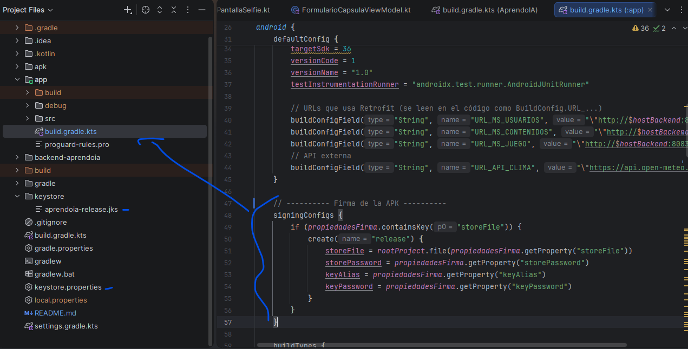
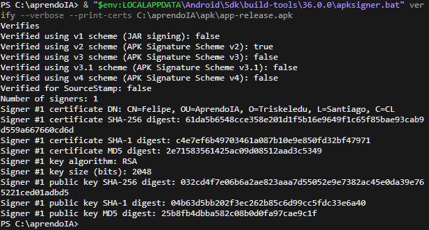

# Aprendo IA Jugando en Santiago

Aplicación móvil Android (Kotlin + Jetpack Compose) con backend de microservicios Spring Boot.
Caso de estudio: **Triskeledu – Aprendo IA Jugando en Santiago**.

- **Asignatura:** [NOMBRE DE LA ASIGNATURA] ([SIGLA])
- **Evaluación:** Evaluación Parcial 4

## 1. Integrantes

| Nombre y apellidos | RUT |
|---|---|
| [NOMBRE APELLIDO APELLIDO] | [RUT] |

## 2. Estructura del repositorio

```
AprendoIA/                      ← raíz del proyecto Android (se abre en Android Studio)
├── app/                        ← código fuente de la app móvil
├── backend-aprendoia/          ← proyecto Maven con los 3 microservicios Spring Boot
│   ├── ms-usuarios/            (puerto 8081)
│   ├── ms-contenidos/          (puerto 8082)
│   └── ms-juego/               (puerto 8083)
├── keystore/aprendoia-release.jks   ← llave de firma del APK
├── keystore.properties         ← configuración de la firma (la lee app/build.gradle.kts)
├── apk/app-release.apk         ← APK firmado
└── docs/capturas/              ← capturas para este README
```

## 3. Funcionalidades

**Jugador (Cliente)**
- Registro con validaciones en vivo (nombre, correo, teléfono, contraseña) e inicio de sesión contra **ms-usuarios**.
- Mapa de Santiago (OSMDroid) con los puntos turísticos descubiertos y pendientes.
- Escaneo de códigos QR con la cámara: **ms-juego** valida el código en **ms-contenidos** y suma 10 puntos.
- Cápsula de IA en video, marcada como vista en el servidor.
- Desafío de selfie en hitos turísticos (+100 puntos), con foto tomada por la cámara.
- Colección, puntaje y niveles, logros, gráfico semanal, historial y notificaciones.
- **Clima actual de Santiago (API externa Open-Meteo)** en el Dashboard y en el detalle de cada punto.
- Funciona sin conexión: Room guarda una copia local y lo hecho offline se sube al volver la conexión.

**Administrador y Creador de contenido (panel de gestión)**
- CRUD de puntos turísticos (solo Administrador) contra **ms-contenidos**.
- CRUD de cápsulas de IA; el Administrador publica, el Creador deja cápsulas pendientes.
- Generación del código QR de cada cápsula para imprimirlo.
- CRUD de jugadores (editar / eliminar) contra **ms-usuarios** y **ms-juego**.

## 4. Pantallas desarrolladas

1. Bienvenida
2. Registro de jugador
3. Selección de jugador / inicio de sesión
4. Dashboard (con clima de Open-Meteo)
5. Mapa de puntos turísticos
6. Detalle del punto (con clima de Open-Meteo)
7. Escáner QR
8. Resultado del QR
9. Video de la cápsula de IA
10. Desafío selfie
11. Colección
12. Puntaje y progreso
13. Historial de actividades
14. Notificaciones
15. Perfil

Pantallas adicionales del panel de gestión: Panel de gestión, Editar jugador / perfil, Lista de puntos,
Formulario de punto, Lista de cápsulas, Formulario de cápsula y Código QR de la cápsula.

## 5. Endpoints

### 5.1 Microservicios propios

Cada microservicio publica su documentación en `http://localhost:<puerto>/swagger-ui.html`.
Los errores se devuelven como JSON: `{"fecha", "estado", "error", "campos"}`.

**ms-usuarios — `http://localhost:8081`**

| Método | Endpoint | Descripción |
|---|---|---|
| GET | `/api/usuarios?rol=CLIENTE` | Lista usuarios (filtro de rol opcional) |
| GET | `/api/usuarios/{id}` | Obtiene un usuario |
| POST | `/api/usuarios` | Registra un jugador (rol CLIENTE) |
| PUT | `/api/usuarios/{id}` | Actualiza un usuario (contraseña vacía = se mantiene) |
| DELETE | `/api/usuarios/{id}` | Elimina un jugador (las cuentas del sistema están protegidas) |
| POST | `/api/usuarios/login` | Valida `usuarioId` + `password` |

**ms-contenidos — `http://localhost:8082`**

| Método | Endpoint | Descripción |
|---|---|---|
| GET | `/api/puntos` | Lista los puntos turísticos |
| GET | `/api/puntos/{id}` | Obtiene un punto |
| POST | `/api/puntos` | Crea un punto |
| PUT | `/api/puntos/{id}` | Actualiza un punto |
| DELETE | `/api/puntos/{id}` | Elimina un punto y sus cápsulas |
| GET | `/api/capsulas?publicadas=true&puntoId=1` | Lista cápsulas (filtros opcionales) |
| GET | `/api/capsulas/{id}` | Obtiene una cápsula |
| GET | `/api/capsulas/codigo/{codigo}` | Busca una cápsula publicada por su código QR |
| POST | `/api/capsulas` | Crea una cápsula (409 si el código QR ya existe) |
| PUT | `/api/capsulas/{id}` | Actualiza una cápsula |
| PATCH | `/api/capsulas/{id}/publicar` | Publica una cápsula |
| DELETE | `/api/capsulas/{id}` | Elimina una cápsula |

**ms-juego — `http://localhost:8083`** (consulta a ms-contenidos con `RestClient`)

| Método | Endpoint | Descripción |
|---|---|---|
| POST | `/api/descubrimientos` | Registra el escaneo de un QR (+10 puntos si es nuevo) |
| GET | `/api/descubrimientos?usuarioId=3` | Cápsulas descubiertas por el jugador |
| PUT | `/api/descubrimientos/visto` | Marca el video de una cápsula como visto |
| POST | `/api/selfies` | Registra la selfie de un hito (+100 puntos) |
| GET | `/api/selfies?usuarioId=3` | Selfies del jugador |
| DELETE | `/api/selfies/{id}` | Elimina una selfie |
| GET | `/api/historial?usuarioId=3` | Historial de actividades |
| GET | `/api/estadisticas/{usuarioId}` | Puntaje, QR, videos, selfies y lugares |
| GET | `/api/ranking?limite=10` | Ranking de jugadores |
| DELETE | `/api/progreso/{usuarioId}` | Borra todo el progreso de un jugador |

### 5.2 API externa — Open-Meteo (sin API key)

| Método | Endpoint | Uso en la app |
|---|---|---|
| GET | `https://api.open-meteo.com/v1/forecast?latitude=-33.4378&longitude=-70.6505&current=temperature_2m,apparent_temperature,relative_humidity_2m,wind_speed_10m,weather_code,is_day&timezone=America/Santiago` | Clima actual en el Dashboard y en el Detalle del punto |

Se consume con Retrofit (`ClimaApi` → `ClimaRepository`). No guarda nada en Room ni pasa por los
microservicios: si falla, solo la tarjeta del clima muestra un aviso con botón *Reintentar*.

## 6. Pasos para ejecutar

### 6.1 Backend (Spring Boot)

Requisitos: **JDK 17** y **Maven 3.9+** (o IntelliJ IDEA, que trae Maven).

**Opción A — MySQL (XAMPP / Laragon / MySQL Server)**
1. Encender MySQL en el puerto 3306 (usuario `root` sin contraseña por defecto).
   Si tu usuario es otro: definir las variables `DB_USER` y `DB_PASSWORD`.
2. No hay que crear nada a mano: cada microservicio **crea su base de datos**
   (`aprendoia_usuarios`, `aprendoia_contenidos`, `aprendoia_juego`) y la **pobla** con
   `schema.sql` + `data.sql` al iniciar.
3. Levantar los tres microservicios, cada uno en su propia terminal y **en este orden**:
   ```bash
   cd backend-aprendoia
   mvn -pl ms-usuarios spring-boot:run
   mvn -pl ms-contenidos spring-boot:run
   mvn -pl ms-juego spring-boot:run
   ```

**Opción B — sin MySQL (base H2 en memoria)**
```bash
mvn -pl ms-usuarios spring-boot:run -Dspring-boot.run.profiles=h2
mvn -pl ms-contenidos spring-boot:run -Dspring-boot.run.profiles=h2
mvn -pl ms-juego spring-boot:run -Dspring-boot.run.profiles=h2
```

4. Comprobar: abrir `http://localhost:8082/api/puntos` (debe mostrar 8 puntos) o el Swagger de cada servicio.
5. Pruebas del backend: `mvn test`.

Usuarios de prueba: Administrador (id 1, contraseña `123`), Creador de contenido (id 2, `123`),
Ana González (id 3, `1234`), Carlos Muñoz (id 4, `1234`).

### 6.2 Frontend (app Android)

1. Abrir la carpeta raíz en **Android Studio** y esperar la sincronización de Gradle.
2. Con los microservicios encendidos, ejecutar la app en el **emulador**: usa `10.0.2.2`, que apunta al PC.
3. En un **teléfono físico**: cambiar `hostBackend` en `app/build.gradle.kts` por la IP local del PC
   (por ejemplo `192.168.1.20`); el teléfono y el PC deben estar en la misma red Wi-Fi.
4. Códigos QR de prueba: `QR-PLAZA-ARMAS`, `QR-SANTA-LUCIA`, `QR-PARQUE-FORESTAL`, `QR-BELLAS-ARTES`,
   `QR-LASTARRIA`, `QR-LA-MONEDA`, `QR-SAN-CRISTOBAL`, `QR-BIBLIOTECA` (también se generan desde el panel).

### 6.3 Pruebas unitarias de la app (JUnit 4 + MockK + kotlinx-coroutines-test)

```bash
./gradlew testDebugUnitTest                  # ejecuta las pruebas
./gradlew createDebugUnitTestCoverageReport  # reporte de cobertura (JaCoCo)
```
Reporte: `app/build/reports/coverage/test/debug/index.html`. La cobertura exigida se revisa en los
paquetes `data.repository` y en los ViewModel de `ui.*`.

Pruebas incluidas: `UsuarioRepositoryTest`, `JuegoRepositoryTest`, `GestionRepositoryTest`,
`SincronizacionRepositoryTest`, `ClimaRepositoryTest`, `RegistroViewModelTest`, `SeleccionViewModelTest`,
`EscanerViewModelTest`, `MapaViewModelTest`, `DashboardViewModelTest`, `FormulariosGestionViewModelTest`,
`ListasYNotificacionesViewModelTest`, `JugadorViewModelsTest`, `GestionYPerfilViewModelsTest`,
`ExperienciaJugadorViewModelsTest` y `UiStatesTest`.

## 7. APK firmado y llave (.jks)

- Llave: `keystore/aprendoia-release.jks` (alias `aprendoia`).
- Configuración: `keystore.properties` en la raíz, leída por `signingConfigs` en `app/build.gradle.kts`:
  ```properties
  storeFile=keystore/aprendoia-release.jks
  storePassword=********
  keyAlias=aprendoia
  keyPassword=********
  ```
- Generar el APK firmado: `./gradlew assembleRelease` → `app/build/outputs/apk/release/app-release.apk`
  (copiado en `apk/app-release.apk`).
- Verificar la firma: `apksigner verify --print-certs apk/app-release.apk`





> La llave y sus contraseñas se dejan en el repositorio solo porque la evaluación lo pide.
> En un proyecto real nunca se suben a un repositorio público.

## 8. Tecnologías

Kotlin · Jetpack Compose · Material 3 · MVVM + StateFlow · Room · Retrofit + Gson · OkHttp ·
OSMDroid · Google Code Scanner · cámara (ActivityResult TakePicture) · ZXing · Spring Boot 3.5 · Spring Data JPA ·
Bean Validation · springdoc-openapi · MySQL / H2 · JUnit · MockK · Mockito.
